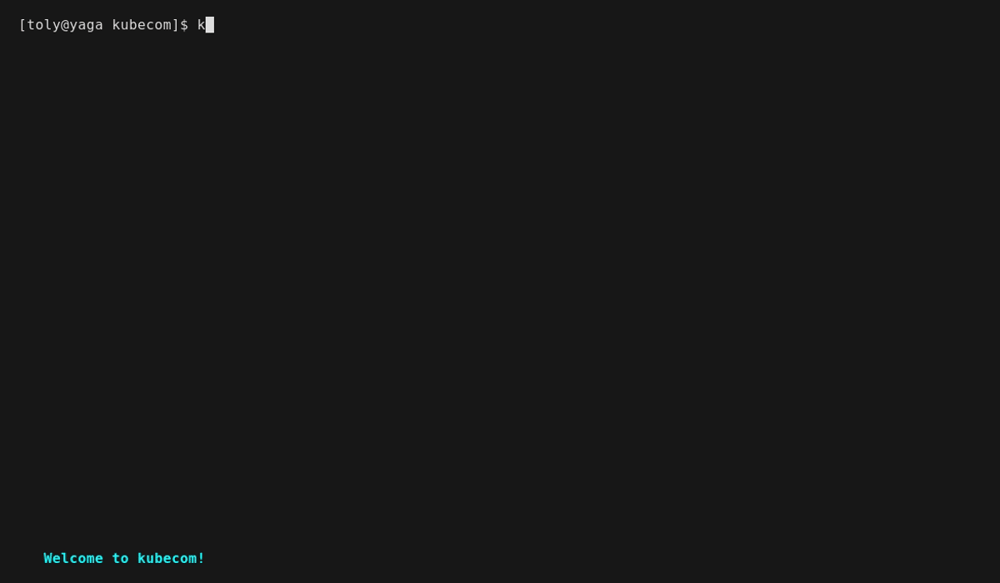

<div align="center">

# kubecom

**The Kubernetes dashboard in your terminal.**

A fast, vim-friendly, zero-deploy Kubernetes TUI. Browse and operate any cluster
over SSH, in real time — one static binary, nothing to deploy in the cluster, and
**no `kubectl` required**.

[](https://github.com/neuroplastio/kubecom/actions/workflows/ci.yml)
[](https://github.com/neuroplastio/kubecom/releases)
[](LICENSE)
[](go.mod)
[](#requirements)

<!-- docs:screencast src=docs/screencast.cast -->


</div>

## Quick start

No root, no package manager — this installs a thin **launcher** and a self-updating
build into your home:

```sh
curl -fsSL https://kubecom.neuroplast.io/install.sh | sh
```

The installer, served by [kubecom.neuroplast.io](https://kubecom.neuroplast.io),
checks the release against a pinned signing key, puts `kubecom` in
`~/.local/bin`, and seeds a build in `~/.local/kubecom` so the first run needs no
network. From then on `kubecom update` keeps it current, outside any package
manager.

```sh
kubecom          # browse your current kubeconfig context
```

Prefer a package manager?

```sh
brew install neuroplastio/tap/kubecom   # macOS, and Homebrew on Linux
yay -S kubecom-bin                       # Arch (AUR)
```

Or build from source:

```sh
go install github.com/neuroplastio/kubecom/cmd/kubecom@main
```

Every install path is in **[`docs/install.md`](docs/install.md)**.

### Requirements

Linux or macOS (Windows via WSL2), and a kubeconfig. Nothing else — no
cluster-side component, no `kubectl`.

## Why kubecom

- **Zero deploy.** A single static binary you run locally or over SSH.
- **Real-time.** Lists are server-side watched and update live; no refresh key.
- **In-process.** Discovery, list/watch, logs, describe, YAML and every action run
  through client-go — not by shelling out.
- **Vim-first, fully rebindable.** `hjkl`, `gg`/`G`, `/`, `n`/`N` by default, with
  arrows and classic keys as an equivalent fallback — and every key is
  configurable.
- **Approachable.** Simpler and more discoverable than k9s, by design.

## What you can do

Every key below is a default — all rebindable in the config's `keymap`, per context. The
full list is generated in [`docs/keybindings.md`](docs/keybindings.md); `?` opens
the help overlay, and `:` opens the command palette, which lists every app-wide
verb and every action on the selected row.

### Browse

- **Live tables** for any resource, including CRDs, with kubectl-identical columns.
- **`hjkl`** (or arrows) move and switch panes; `gg`/`G`, half/full-page keys.
- **`:resource`** switches kind and accepts what you'd type at the kubectl prompt —
  plural, short name, or API group.
- **Namespaces and contexts** switch on the fly; kubecom remembers the namespace
  and resource you last used per context, and comes back to them next time.
- **Metrics** columns for Pods and Nodes when metrics-server is present — and
  sortable.
- **Drill in** to a workload (Deployment, Node, …) to a live watch of its pods; the
  scope is restored when you return.
- **Mouse off by default**, so native text selection works; toggle it to click.

### Find

- **`/`** filters whichever pane is focused — kinds in the menu, rows in the table.
- **`H`** narrows the current table to what's unhealthy (CrashLoopBackOff,
  ImagePullBackOff, Pending, not-ready, a stuck claim).
- **`U`** sweeps **every kind** for what's broken — pod *and* non-pod (a stuck PVC,
  an unschedulable workload), streaming as it scans.
- **Cluster search** (`:search`) across kinds, fuzzy-ranked, with `-l app=web`
  label selectors, a live preview of the highlighted hit, and one `enter` to open
  it.
- **`:` command palette** — app-wide verbs plus the selected row's actions, filtered
  as you type.

### Inspect

- **Describe** fills the right pane, painted so status, conditions and events are
  what your eye lands on. **YAML** opens in your real `$EDITOR`; saving applies it
  with validation and conflict checking. **`E`** lists the object's own events.
- **Logs** in a dedicated full-screen view: live tail, grep (substring or regex),
  a `[following]` badge you can trust, wrap, timestamps, the previous container
  (`-p`), and a visual mode to yank exact lines.
- **`gr` relations** — the owner that made it, the pods it owns, the node it runs
  on, and the claims, config maps and secrets it mounts, grouped by direction, each
  row opening what it names.
- **Secrets** are masked; reveal or copy a decoded value without it hitting the
  screen.

### Act

The actions menu lists only what applies to the selected row, and names its target.

| Action | Applies to |
|--------|-----------|
| Describe · Events · Related resources | anything you can `get` |
| View / Edit YAML | anything you can `get` |
| Logs | Pod, Deployment, ReplicaSet, StatefulSet, DaemonSet, Job, ReplicationController |
| Show pods | those, plus Service and Node |
| Reveal secret | Secret |
| Scale | Deployment, ReplicaSet, StatefulSet, ReplicationController |
| Rollout restart | Deployment, DaemonSet, StatefulSet |
| Cordon / Uncordon / Drain | Node |
| Suspend / Resume | CronJob |
| Port-forward | Pod, Service |
| Exec shell | Pod |
| Delete | anything you can `delete` |

**Exec** suspends into a shell using in-process SPDY (or `kubectl exec` when it is
installed). **Port-forward** runs in the background with a panel to manage
forwards.

### Make it yours

- **Keys** — every action rebindable, in context: a key can mean one thing on
  the Pods table and another everywhere else. `kubecom keys` prints what is in force.
- **Themes** — **Fourteen are built in**, including Catppuccin, Nord, Solarized
  and gruvbox; kubecom sets your terminal background to match.
- **Menus and CRDs** — a `menu` in `config.kdl` adds custom resource types, for
  every context or one; the rest stay
  one `/` or `:resource` away, with a `+N custom` row telling you how many are held
  back. **Pin** the kinds you live in.
- **Resume** — kubecom opens on Pods, then wherever you left off per context.

### When something breaks

A resource whose LIST fails says **why in the table itself** — RBAC, credentials,
a missing CRD, an unreachable conversion webhook, the server's own words, and
whether the fix is yours or the cluster's. An expired credential plugin (an AWS SSO
session, say) is recognised, and kubecom offers to run the exact login for you
once. Every error also lands in full in `~/.cache/kubecom/kubecom.log`.

## Configure

kubecom needs no configuration. When you want some, it reads
`~/.config/kubecom/config.kdl`, and never writes it:

```kdl
version 1
theme "catppuccin-mocha"

keymap {
    bind "g p" "resources.switch" "pods"
    context "cluster.context.startsWith('prod-')" {
        unbind "D"  // no delete key on production
    }
}
```

[`docs/configuration.md`](docs/configuration.md) covers the config file, key
bindings and their contexts, themes, per-context menus, pinned kinds, and how much
it remembers.
[`docs/keybindings.md`](docs/keybindings.md) is the generated key reference.

## Update

`kubecom update` fetches the newest build of this kubecom's channel, verifies it
against the signing key built into the binary, and installs it next to itself — or,
installed from a package, into `~/.local/kubecom` for the launcher to run. It is
also `:update` in the UI. Details: [`docs/install.md`](docs/install.md#updating).

## Command line

```bash
kubecom                          # browse the current context, all namespaces
kubecom --context prod -n web    # a specific context and namespace
kubecom --kubeconfig ~/.kube/x   # a specific kubeconfig
kubecom update                   # update to the newest build of its channel
kubecom version                  # build information
kubecom keys                     # the keymap in force, and where each key comes from
kubecom keys default             # the default keymap (default.kdl)
kubecom keys check               # check your keymap without starting kubecom
kubecom keys analyze trace.jsonl # read a --keylog trace back as findings
```

`--keylog <file>` records what you pressed and how it resolved — the instrument
behind [`stories/`](stories/). It is off unless you ask.

## Contributing

The rewrite is driven autonomously against the plan in [`vault/`](vault/) —
goals, milestones, the live board, the decision log. If you'd like to contribute,
open an issue first so we can align with the milestone plan; see
[`CONTRIBUTING.md`](CONTRIBUTING.md).

If what you want to change is how kubecom *feels* rather than what it does, write a
**story**: the situation that made you want the change, so somebody else can walk
it. There are five in [`stories/`](stories/) to copy the shape from.

## Special thanks

- [Bubble Tea / Bubbles / Lipgloss](https://github.com/charmbracelet) — the TUI stack
- [client-go](https://github.com/kubernetes/client-go) — in-process Kubernetes access
- [k9s](https://github.com/derailed/k9s) — a contemporary Kubernetes TUI in the same space

---

Licensed under [Apache-2.0](LICENSE). The original 2020 kube-commander lives on the
[`v0`](https://github.com/neuroplastio/kubecom/tree/v0) branch.
